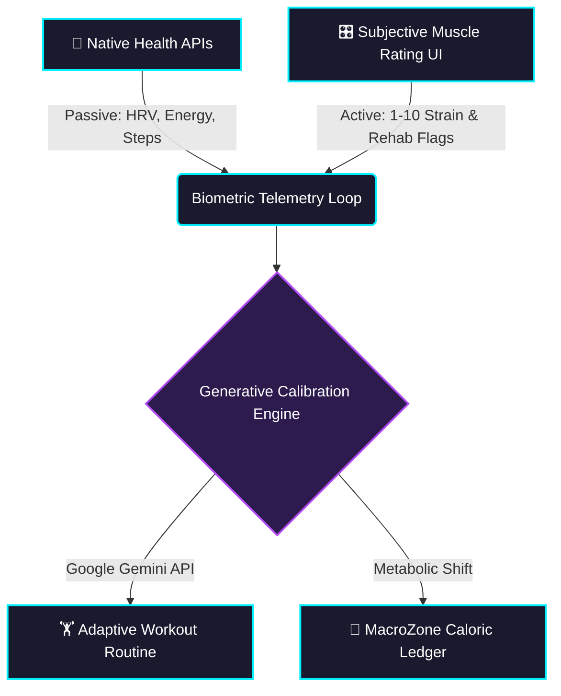

<div align="center">

# ⚡ FITTER

[](https://git.io/typing-svg)

[](https://reactnative.dev/)
[](https://www.typescriptlang.org/)
[](https://expo.dev/)
[](https://aistudio.google.com/)
[](https://developer.apple.com/)

*Workouts, mobility constraints, and macro intake thresholds that dynamically update as your physical thresholds shift.*

<br />


</div>

---

## 🧬 Architecture Overview

FITTER processes user telemetry and health signals through a reactive data pipeline.



1. **Biometric Collection:** Passively samples continuous health indicators via native platform APIs.
2. **Dynamic Muscle Rating:** Users calibrate specific muscle groups and mobility constraints via an interactive strain assessment UI.
3. **Generative Recalibration:** Sends current physical state parameters to Gemini to synthesize customized, safety-bounded exercise regimens.
4. **Execution & Tracking:** Surfaces targeted physical therapy programs alongside a unified nutritional ledger.

---

## 📂 Directory Structure

The project follows a decoupled `src/` layout pattern to ensure strict modular boundaries and maintain Expo Router's typed routing integrity:

```text
FITTER/
├── assets/                  # Static design assets, fonts, icons
├── src/
│   ├── app/                 # 🚀 Expo Router routes (file-based navigation)
│   │   ├── _layout.tsx      # Global Stack navigation shell & providers
│   │   ├── index.tsx        # MacroZone overview dashboard ( / )
│   │   ├── meals.tsx        # Nutritional logs & caloric ledger ( /meals )
│   │   └── rating.tsx       # Neuromuscular calibration ( /rating )
│   ├── components/          # 🧩 Reusable UI components
│   │   └── HealthSync.tsx   # Platform permission bridge
│   ├── styles/              # 🎨 Design system foundations
│   │   └── global.ts        # Dark-mode theme palette & container tokens
│   └── utils/               # ⚙️ Integration services
│       ├── gemini.ts        # Prompt engineering & Gemini client
│       └── health.ts        # HealthKit / Health Connect normalization
├── app.json                 # Native configurations
└── package.json
```

---

## 🚀 Getting Started

### Prerequisites
- **Node.js:** v18.x or later
- **Native Dev Tools:** Xcode 15+ (macOS) for iOS, Android Studio for Android.
- **Google Gemini API Key:** Obtainable via [Google AI Studio](https://aistudio.google.com/).

### Installation

1. **Clone the repository:**
   ```bash
   git clone https://github.com/your-username/fitter.git
   cd fitter
   ```

2. **Install dependencies:**
   ```bash
   npm install
   ```

3. **Configure Environment:**  
   Create a `.env` file at the root:
   ```env
   EXPO_PUBLIC_GEMINI_API_KEY=your_gemini_api_key_here
   ```

4. **Generate Native Directories (Dev Client):**  
   *Note: HealthKit and Health Connect rely on native device capabilities unavailable in default Expo Go.*
   ```bash
   npx expo prebuild
   ```

5. **Run on a physical device or emulator:**
   ```bash
   npx expo run:ios      # iOS (Requires macOS)
   npx expo run:android  # Android
   ```

---

## 🔐 Telemetry & Biometrics Configuration

### 🍎 Apple HealthKit (iOS)
FITTER monitors step count, active energy burned, and mobility metrics. Permissions are pre-configured in `app.json` under `ios.infoPlist`:
```json
"ios": {
  "infoPlist": {
    "NSHealthShareUsageDescription": "FITTER requires read access to health data to calibrate recovery workouts based on daily strain.",
    "NSHealthUpdateUsageDescription": "FITTER requires write access to log completed rehabilitation sessions."
  }
}
```

### 🤖 Google Health Connect (Android)
Android integrations use the new Health Connect schema via the `app.json` config plugins:
```json
"android": {
  "permissions": [
    "android.permission.health.READ_STEPS",
    "android.permission.health.READ_ACTIVE_CALORIES_BURNED"
  ]
}
```

---

## 🗺️ Roadmap

- [x] Strict `src/app` file-based routing architecture
- [x] Initial design tokens and dark-mode layout foundation
- [ ] Direct HealthKit / Health Connect native bridge integration
- [ ] Gemini API structured JSON schema validation for recovery plans
- [ ] On-device historical strain trend graphing (Reanimated / Skia)

---
<div align="center">
  <i>Built for the adaptive athlete.</i>
</div>
